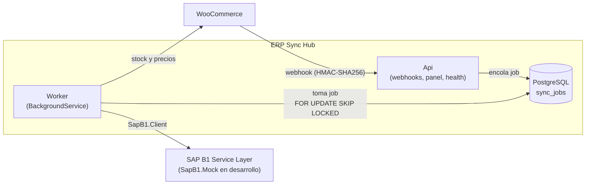

# ERP Sync Hub

[](https://github.com/nachoLuarca/erp-sync-hub/actions/workflows/ci.yml)


[](LICENSE)

Middleware que sincroniza una tienda **WooCommerce** con **SAP Business One** (Service Layer), con idempotencia, reintentos y trazabilidad de cada operación.

## Qué problema resuelve

Una tienda online y un ERP viven en sistemas distintos, con modelos de datos, disponibilidad y tiempos de respuesta distintos. Conectarlos con llamadas directas es frágil: un pedido se pierde si SAP está caído, se duplica si el webhook se reintenta, y nadie sabe qué falló ni por qué.

ERP Sync Hub se interpone entre ambos y se encarga de:

1. **Pedidos tienda → SAP:** recibe el webhook de WooCommerce, lo persiste como *job* y un worker crea el cliente (si no existe) y la Orden de Venta en SAP.
2. **Stock y precios SAP → tienda:** sincronización periódica de inventario y precios hacia WooCommerce.
3. **Confiabilidad:** idempotencia, reintentos con backoff exponencial y *dead letter* para lo que no se puede resolver solo.
4. **Panel (API):** consultar jobs, ver errores y reintentar manualmente.

## Arquitectura



El código sigue **Clean Architecture** ([ADR 0002](docs/adr/0002-clean-architecture.md)); la regla de dependencias está validada por tests de arquitectura:

```
Api ──► Application ──► Domain
 └────► Infrastructure ─┬─► Application
                        ├─► Domain
                        └─► SapB1.Client   (independiente del hub)
```

| Proyecto | Responsabilidad |
|---|---|
| `ErpSyncHub.Domain` | Entidades y reglas puras, sin dependencias externas. |
| `ErpSyncHub.Application` | Casos de uso e interfaces (`ISapGateway`, `IStoreGateway`…). |
| `ErpSyncHub.Infrastructure` | EF Core/PostgreSQL, clientes HTTP y adaptadores. |
| `ErpSyncHub.Api` | Minimal APIs (webhooks, panel, health) y hospedaje del worker. |
| `SapB1.Client` | Cliente tipado del Service Layer, publicable en NuGet ([guía](src/SapB1.Client/README.md)). |
| `SapB1.Mock` | SAP simulado según el contrato oficial del Service Layer ([guía](docs/sap-mock.md), [ADR 0004](docs/adr/0004-sap-simulado-segun-contrato-service-layer.md)). |

## Stack

- .NET 10 / C# 14, Minimal APIs, OpenAPI + Scalar
- PostgreSQL 17 (datos y cola de jobs, [ADR 0003](docs/adr/0003-postgresql-como-cola.md)) con EF Core
- Serilog, Options pattern con validación al inicio, ProblemDetails (RFC 9457)
- Pruebas: xUnit, Shouldly, NSubstitute, Testcontainers, NetArchTest
- Docker Compose y GitHub Actions

## Cómo levantarlo

Requisitos: [.NET SDK 10](https://dotnet.microsoft.com/download) y Docker.

```bash
# 1. Configuración local (el archivo .env no se versiona)
cp .env.example .env        # y completa los valores marcados como OBLIGATORIO

# 2. Infraestructura: PostgreSQL y SAP simulado
docker compose up -d --build

# 3. La API: necesita la cadena de conexión a la base de datos (con la contraseña de tu .env)
export Database__ConnectionString="Host=localhost;Port=5432;Database=erpsynchub;Username=erpsynchub;Password=<POSTGRES_PASSWORD>"
export Database__MigrateOnStartup=true      # aplica las migraciones al iniciar (solo desarrollo)
export Webhooks__WooCommerce__Secret="<mínimo 16 caracteres; el mismo que el secreto del webhook en WooCommerce>"
export SAP__BaseUrl="http://localhost:5100"            # el SAP simulado de Docker Compose
export SAP__CompanyDb="SBODemoCL"
export SAP__UserName="manager"
export SAP__Password="manager"                          # credenciales ficticias del mock; con un SAP real, usa un gestor de secretos
dotnet run --project src/ErpSyncHub.Api
```

| Servicio | URL |
|---|---|
| API | `http://localhost:5191/health` |
| Documentación (solo desarrollo) | `http://localhost:5191/scalar` |
| SAP simulado (Docker) | `http://localhost:5100/health` |
| PostgreSQL | `localhost:5432` |

Tienda WooCommerce opcional, con WordPress y MySQL:

```bash
docker compose --profile tienda up -d
docker compose --profile tienda run --rm tienda-setup   # instala WordPress y WooCommerce
```

La tienda queda en `http://localhost:8081`.

### Desarrollo

```bash
dotnet build -c Release
dotnet format --verify-no-changes
dotnet test
```

#### Verificación en contenedor

`scripts/test.ps1` ejecuta restore, build en Release, `dotnet format --verify-no-changes` y todos los tests dentro del contenedor `mcr.microsoft.com/dotnet/sdk:10.0`, igual que CI. Es la forma recomendada de correr los tests en Windows con Smart App Control activo, que impide a `testhost.exe` cargar los ensamblados recién compilados.

```powershell
./scripts/test.ps1                                              # verificación completa
./scripts/test.ps1 -Filter "FullyQualifiedName~SapB1.Client"    # solo algunos tests
./scripts/test.ps1 -SkipFormat                                  # sin verificar el formato
```

Requiere Docker en ejecución. El repositorio se monta como solo lectura y el script trabaja sobre una copia, de modo que no altera tus carpetas `bin/` y `obj/`. La caché de NuGet se conserva en el volumen Docker `erp-sync-hub-nuget`. El código de salida es distinto de 0 si algún paso falla.

Los tests de integración usan [Testcontainers](https://dotnet.testcontainers.org/) con un PostgreSQL real. Para que funcionen desde dentro del contenedor, el script monta el socket del Docker del host (`/var/run/docker.sock`): los contenedores de prueba se crean como "hermanos" en tu Docker y los tests los alcanzan por `host.docker.internal`. Montar el socket da al contenedor de tests control sobre el Docker del host, lo que es aceptable en una máquina de desarrollo; no ejecutes el script con código que no sea de confianza.

En CI (GitHub Actions) no hace falta nada de esto: el runner ya tiene Docker y los tests corren directamente en él.

## Estado por fase

| Fase | Entregable | Versión | Estado |
|---|---|---|---|
| 0 | Cimientos: solución, capas, configuración, tests de arquitectura, Docker Compose, CI, documentación | v0.1.0 | ✅ Completa |
| 1 | `SapB1.Mock` y `SapB1.Client` (login y renovación de sesión, Items, BusinessPartners, Orders) | v0.2.0 | ✅ Completa |
| 2 | Webhook con firma HMAC-SHA256, tabla `sync_jobs`, worker con cola en PostgreSQL | v0.3.0 | ⏳ Pendiente |
| 3 | Sincronización periódica de stock y precios SAP → WooCommerce | v0.4.0 | ⏳ Pendiente |
| 4 | Backoff, dead letter, panel, reintento manual, simulación de fallas en el mock | v0.5.0 | ⏳ Pendiente |
| 5 | Despliegue, diagrama final, NuGet de `SapB1.Client`, release automatizado | v1.0.0 | ⏳ Pendiente |

## Documentación

- [SapB1.Mock](docs/sap-mock.md): endpoints, datos semilla y fidelidad al contrato del Service Layer.
- [SapB1.Client](src/SapB1.Client/README.md): configuración, uso, sesión y errores.

## Decisiones de arquitectura

Las decisiones relevantes están registradas en [`docs/adr`](docs/adr/README.md).

## Licencia

[MIT](LICENSE) © 2026 Ignacio Luarca
