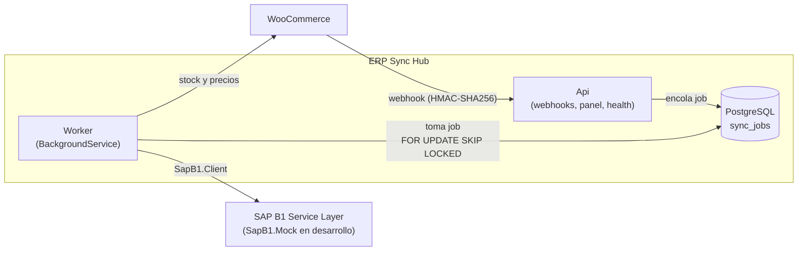

# ERP Sync Hub

[](https://github.com/nachoLuarca/erp-sync-hub/actions/workflows/ci.yml)


[](LICENSE)

Middleware que sincroniza una tienda **WooCommerce** con **SAP Business One** (Service Layer), con idempotencia, reintentos y trazabilidad de cada operación.

## Qué problema resuelve

Una tienda online y un ERP viven en sistemas distintos, con modelos de datos, disponibilidad y tiempos de respuesta distintos. Conectarlos con llamadas directas es frágil: un pedido se pierde si SAP está caído, se duplica si el webhook se reintenta, y nadie sabe qué falló ni por qué.

ERP Sync Hub se interpone entre ambos y se encarga de:

1. **Pedidos tienda → SAP:** recibe el webhook de WooCommerce, lo persiste como *job* y un worker crea el cliente (si no existe) y la Orden de Venta en SAP.
2. **Stock y precios SAP → tienda:** sincronización periódica de inventario y precios hacia WooCommerce.
3. **Confiabilidad:** idempotencia, reintentos con backoff exponencial y *dead letter* para lo que no se puede resolver solo.
4. **Panel (API):** consultar jobs, ver errores y reintentar manualmente.

## Arquitectura



El código sigue **Clean Architecture** ([ADR 0002](docs/adr/0002-clean-architecture.md)); la regla de dependencias está validada por tests de arquitectura:

```
Api ──► Application ──► Domain
 └────► Infrastructure ─┬─► Application
                        ├─► Domain
                        └─► SapB1.Client   (independiente del hub)
```

| Proyecto | Responsabilidad |
|---|---|
| `ErpSyncHub.Domain` | Entidades y reglas puras, sin dependencias externas. |
| `ErpSyncHub.Application` | Casos de uso e interfaces (`ISapGateway`, `IStoreGateway`…). |
| `ErpSyncHub.Infrastructure` | EF Core/PostgreSQL, clientes HTTP y adaptadores. |
| `ErpSyncHub.Api` | Minimal APIs (webhooks, panel, health) y hospedaje del worker. |
| `SapB1.Client` | Cliente tipado del Service Layer, publicable en NuGet ([guía](src/SapB1.Client/README.md)). |
| `SapB1.Mock` | SAP simulado según el contrato oficial del Service Layer ([guía](docs/sap-mock.md), [ADR 0004](docs/adr/0004-sap-simulado-segun-contrato-service-layer.md)). |

## Stack

- .NET 10 / C# 14, Minimal APIs, OpenAPI + Scalar
- PostgreSQL 17 (datos y cola de jobs, [ADR 0003](docs/adr/0003-postgresql-como-cola.md)) con EF Core
- Serilog, Options pattern con validación al inicio, ProblemDetails (RFC 9457)
- Pruebas: xUnit, Shouldly, NSubstitute, Testcontainers, NetArchTest
- Docker Compose y GitHub Actions

## Cómo levantarlo

Requisitos: [.NET SDK 10](https://dotnet.microsoft.com/download) y Docker.

```bash
# 1. Variables obligatorias (ver "Variables de entorno" más abajo para dejarlas permanentes)
export ERPSYNC_POSTGRES_PASSWORD='<elige una contraseña>'
export ERPSYNC_WC_WEBHOOK_SECRET='<mínimo 16 caracteres>'

# 2. Entorno completo: PostgreSQL, SAP simulado, Seq y el hub (ya queda funcionando en http://localhost:5200)
docker compose up -d --build        # PostgreSQL, el SAP simulado y el hub; la tienda es opcional (--profile tienda)

# 3. Opcional, para desarrollar: el hub desde el código (puerto 5210; apaga el contenedor `hub` si quieres un solo worker). Necesita la cadena de conexión a la base de datos (con la contraseña de ERPSYNC_POSTGRES_PASSWORD)
export Database__ConnectionString="Host=localhost;Port=5433;Database=erpsynchub;Username=erpsynchub;Password=<POSTGRES_PASSWORD>"
export Database__MigrateOnStartup=true      # aplica las migraciones al iniciar (solo desarrollo)
export Webhooks__WooCommerce__Secret="<mínimo 16 caracteres; el mismo que el secreto del webhook en WooCommerce>"
export SAP__BaseUrl="http://localhost:5201"            # el SAP simulado de Docker Compose
export SAP__CompanyDb="SBODemoCL"
export SAP__UserName="manager"
export SAP__Password="manager"                          # credenciales ficticias del mock; con un SAP real, usa un gestor de secretos
dotnet run --project src/ErpSyncHub.Api
```

### Variables de entorno

No hay archivo de configuración en el repositorio: todo entra por variables de entorno, y las de Docker Compose llevan el prefijo `ERPSYNC_` para no chocar con otros proyectos locales. La tabla completa (obligatoria o no, valor por defecto y para qué sirve) está en [docs/variables-de-entorno.md](docs/variables-de-entorno.md). Las obligatorias para el entorno por defecto son `ERPSYNC_POSTGRES_PASSWORD` y `ERPSYNC_WC_WEBHOOK_SECRET`; con la tienda, además `ERPSYNC_WP_DB_PASSWORD` y `ERPSYNC_WP_ADMIN_PASSWORD`; y para usar el [panel](docs/panel.md), `ERPSYNC_ADMIN_OPERATE_API_KEYS` (y, para consultar sin poder actuar, `ERPSYNC_ADMIN_READ_API_KEYS`; sin ninguna de las dos el panel responde 503 y el resto del hub funciona).

**Windows (permanente, nivel usuario).** Abre una terminal nueva después de definirlas; las ya abiertas no las ven. Compose lee el entorno de la terminal desde la que lo ejecutas, así que no hace falta reiniciar Docker Desktop.

```powershell
[Environment]::SetEnvironmentVariable('ERPSYNC_POSTGRES_PASSWORD', '<contraseña>', 'User')
[Environment]::SetEnvironmentVariable('ERPSYNC_WC_WEBHOOK_SECRET', '<mínimo 16 caracteres>', 'User')
# Para revisarla:  [Environment]::GetEnvironmentVariable('ERPSYNC_POSTGRES_PASSWORD', 'User')
# Para borrarla:   [Environment]::SetEnvironmentVariable('ERPSYNC_POSTGRES_PASSWORD', $null, 'User')
```

**Linux y macOS.** Para la sesión actual, `export`; para que sean permanentes, agrégalas a `~/.profile` (o `~/.bashrc`, `~/.zshrc`).

```bash
export ERPSYNC_POSTGRES_PASSWORD='<contraseña>'
export ERPSYNC_WC_WEBHOOK_SECRET='<mínimo 16 caracteres>'
```

**CI y despliegue (GitHub Actions, Render).** Se definen como secretos o variables de entorno del servicio, nunca en el repositorio. En GitHub Actions: `Settings → Secrets and variables → Actions`, y en el flujo de trabajo `env: ERPSYNC_POSTGRES_PASSWORD: ${{ secrets.ERPSYNC_POSTGRES_PASSWORD }}`. En Render: sección *Environment* del servicio. Allí no interviene Compose, así que lo que se define son las variables del hub (`Database__ConnectionString`, `Webhooks__WooCommerce__Secret`, `SAP__*`).

**El archivo `.env` sigue siendo opcional.** Docker Compose lo lee solo si existe en la raíz del proyecto (está en `.gitignore`), así que puedes usarlo en lugar de las variables del sistema si lo prefieres. Una variable definida en el sistema tiene prioridad sobre la misma dentro de `.env`.
### Servicios y puertos

Los puertos del host se publican solo en `127.0.0.1` y se eligen para no chocar con los de otros proyectos habituales (PostgreSQL 5432, Redis 6379, SMTP 1025…). Cada uno se puede cambiar con su variable `ERPSYNC_*_HOST_PORT` (ver [variables de entorno](docs/variables-de-entorno.md)). Entre contenedores no importan: se hablan por nombre de servicio y puerto interno (`postgres:5432`, `sap-mock:8080`, `seq:80`, `hub:8080`).

| Servicio | En Docker | Con `dotnet run` | URL |
|---|---|---|---|
| API del hub (webhook, panel `/admin`, `/health`) | `5200` (`HUB_HOST_PORT`) | `5210` | http://localhost:5200/health |
| Documentación de la API (Scalar) | — (solo en entorno `Development`) | `5210` | http://localhost:5210/scalar |
| SAP simulado | `5201` (`SAP_MOCK_HOST_PORT`) | `5211` | http://localhost:5201/health |
| Seq (logs estructurados) | `5202` (`SEQ_HOST_PORT`) | — | http://localhost:5202 |
| Tienda WooCommerce (perfil `tienda`) | `5203` (`TIENDA_HOST_PORT`) | — | http://localhost:5203 |
| PostgreSQL | `5433` (`POSTGRES_HOST_PORT`) | — | `localhost:5433` |
| MySQL de la tienda | sin puerto en el host | — | solo desde la red de Compose |

Seq corre sin autenticación porque es solo para desarrollo local: no lo expongas fuera de tu máquina. Para ver los logs de un pedido, filtra por `JobId = '<id del job>'`; para los de una sincronización de stock y precios, por `InventoryRunId = '<id de la ejecución>'`.

#### Si un puerto está ocupado

Compose falla con `port is already allocated`. Revisa qué lo usa y cambia la variable `ERPSYNC_*_HOST_PORT` correspondiente:

```powershell
Get-NetTCPConnection -LocalPort 5433 -ErrorAction SilentlyContinue   # PowerShell
docker ps --format "table {{.Names}}\t{{.Ports}}"                    # contenedores que publican puertos
```

### Cómo levantar el entorno

| Qué quieres | Comando |
|---|---|
| Todo lo del hub: PostgreSQL, SAP simulado, hub y Seq | `docker compose up -d --build --wait` |
| Además, la tienda WooCommerce | `docker compose --profile tienda up -d --build --wait` y luego `docker compose --profile tienda run --rm tienda-setup` |
| Solo la infraestructura, con el hub desde `dotnet run` | `docker compose up -d postgres sap-mock seq` y el bloque anterior (el hub queda en `5210`) |
| Ver el estado | `docker compose ps` · `curl http://localhost:5200/health` |
| Apagar (conserva los datos) | `docker compose down` |
| Apagar y borrar volúmenes | `docker compose down -v` |

Con el hub en `dotnet run`, para enviar sus logs a Seq define `Seq__ServerUrl=http://localhost:5202`; sin esa variable solo escribe en consola. Si además usas la tienda, apunta el webhook al hub del host con `ERPSYNC_HUB_WEBHOOK_URL=http://host.docker.internal:5210/webhooks/woocommerce/orders`.

### Prueba de punta a punta: WooCommerce → hub → SAP

Con Docker Compose se levanta todo el flujo: PostgreSQL, el SAP simulado y el hub (por defecto) y una tienda WooCommerce real (`--profile tienda`). Define al menos `ERPSYNC_POSTGRES_PASSWORD`, `ERPSYNC_WP_DB_PASSWORD`, `ERPSYNC_WP_ADMIN_PASSWORD` y `ERPSYNC_WC_WEBHOOK_SECRET` (mínimo 16 caracteres; ver [variables de entorno](docs/variables-de-entorno.md)).

```bash
# 1. PostgreSQL, el SAP simulado, el hub (se construye desde src/ErpSyncHub.Api/Dockerfile) y la tienda
docker compose --profile tienda up -d --build --wait

# 2. Instala WordPress y WooCommerce, crea productos con SKU A00001, A00002 y A00010 (artículos del SAP simulado)
#    y registra los webhooks order.created y order.updated hacia el hub
docker compose --profile tienda run --rm tienda-setup
```

La tienda queda en `http://localhost:5203` (usuario `admin`). Haz una compra desde la tienda, o crea un pedido pagado desde la consola:

```bash
docker compose --profile tienda run --rm --entrypoint wp tienda-setup wc shop_order create --user=admin \
  --status=processing --line_items='[{"product_id":<id del producto>,"quantity":2}]' \
  --billing='{"first_name":"Valentina","last_name":"Muñoz","email":"valentina@example.com","country":"CL"}' \
  --meta_data='[{"key":"_billing_rut","value":"18.765.432-7"}]'
```

Para seguir lo que pasó:

```bash
curl http://localhost:5200/health                      # estado de PostgreSQL y SAP
docker compose logs hub                                # el webhook recibido y el job procesado
docker compose exec postgres psql -U erpsynchub -c "select external_id, status, sap_doc_entry, last_error_code from sync_jobs"
```

> **Solo desarrollo.** WordPress bloquea por seguridad los webhooks hacia direcciones privadas y puertos no estándar, que es donde corre el hub en Compose. El plugin [`docker/tienda/mu-plugins/permitir-webhooks-locales.php`](docker/tienda/mu-plugins/permitir-webhooks-locales.php) lo permite solo para los hosts de desarrollo y hace la entrega síncrona; **no debe instalarse en una tienda real**, donde la URL del webhook es pública y HTTPS.

Si prefieres ejecutar el hub fuera de Docker, apunta el webhook a tu máquina con `ERPSYNC_HUB_WEBHOOK_URL=http://host.docker.internal:5210/webhooks/woocommerce/orders`.

### Prueba de punta a punta: SAP → hub → WooCommerce (stock y precios)

El hub lee los artículos de SAP cada 15 minutos (`ERPSYNC_INVENTORY_INTERVAL`) y envía a la tienda solo el stock y el precio que cambiaron. Para que pueda llamar a la API de WooCommerce hacen falta, además de lo anterior, `ERPSYNC_WC_CONSUMER_KEY` y `ERPSYNC_WC_CONSUMER_SECRET`: son la única fuente de verdad de las credenciales, y [en las variables de entorno](docs/variables-de-entorno.md#credenciales-de-la-api-de-woocommerce) hay un comando de PowerShell para generarlas. `tienda-setup` las registra en WooCommerce, así que basta con levantar el entorno con la tienda. Sin esas variables, el hub arranca igual y avisa en el log que la sincronización de stock y precios queda desactivada.

```bash
docker compose --profile tienda up -d --build --wait
docker compose --profile tienda run --rm tienda-setup   # registra la clave de API del hub en WooCommerce
```

```powershell
# Cambia el stock y el precio de un artículo en el SAP simulado: en mano 20, comprometido 5 y precio 41990
Invoke-RestMethod -Method Patch -Uri http://localhost:5201/_mock/items/A00001 -ContentType application/json -Body '{"InStock":20,"Committed":5,"Price":41990}'

# Dispara la sincronización sin esperar al intervalo y mira cuántos artículos se leyeron, actualizaron, omitieron o fallaron
Invoke-RestMethod -Method Post -Uri http://localhost:5200/admin/sync/inventory
Invoke-RestMethod -Uri http://localhost:5200/admin/sync/inventory/last
```

El producto `A00001` de la tienda queda con stock 15 (20 en mano menos 5 comprometidos) y precio 41990. El detalle del flujo, el panel y los logs está en [flujo de stock y precios](docs/flujo-de-stock-y-precios.md).

### Resiliencia y panel

Si SAP se cae, el hub sigue aceptando los webhooks de la tienda (202), los jobs quedan `retrying` con espera exponencial y jitter y se completan solos al volver SAP, sin duplicar la orden ni el cliente. Con los valores por defecto (12 intentos, 30 s de base, tope de 1 hora) un job atraviesa una caída de SAP de entre 2 h 32 min y 5 h 4 min de espera acumulada; si dura más, pasa al *dead letter* y se reintenta a mano. Los errores definitivos (SKU sin mapeo, RUT inválido) no se reintentan solos y quedan `failed`.

Si SAP falla de forma sostenida (5 fallas consecutivas en 5 minutos, o credenciales rechazadas), el **circuit breaker** se abre: el worker deja de tomar jobs, que esperan en la cola **sin gastar sus intentos**, y una sola instancia prueba SAP cada cierto tiempo (30 s, que se duplica hasta 15 minutos) hasta que responda ([ADR 0011](docs/adr/0011-circuit-breaker-de-sap.md)). Si SAP rechaza una orden porque el cliente o el artículo de un mapeo guardado ya no existe, el hub elimina el mapeo y lo resuelve de nuevo solo. Los mensajes de SAP y de la tienda salen sin datos personales y recortados ([ADR 0013](docs/adr/0013-redaccion-de-datos-personales.md)).

Todo se ve y se corrige desde el [panel](docs/panel.md), que exige la cabecera `X-Api-Key` con una clave de **lectura** (`ERPSYNC_ADMIN_READ_API_KEYS`) o de **operación** (`ERPSYNC_ADMIN_OPERATE_API_KEYS`, la única que puede reintentar, sincronizar, cerrar el circuito o eliminar mapeos), cada una con varias claves separadas por coma y [procedimiento de rotación](docs/variables-de-entorno.md#rotar-una-clave-sin-cortar-el-acceso):

```powershell
$headers = @{ 'X-Api-Key' = $env:ERPSYNC_ADMIN_OPERATE_API_KEYS.Split(',')[0] }
Invoke-RestMethod 'http://localhost:5200/admin/metrics' -Headers $headers                          # jobs por estado y última sincronización de inventario
Invoke-RestMethod 'http://localhost:5200/admin/jobs?status=failed,dead_letter' -Headers $headers   # lo que necesita atención
Invoke-RestMethod "http://localhost:5200/admin/jobs/$id/retry" -Method Post -Headers $headers      # reintento manual
Invoke-RestMethod 'http://localhost:5200/admin/circuit-breakers' -Headers $headers                    # estado del circuit breaker de SAP
Invoke-RestMethod 'http://localhost:5200/admin/audit' -Headers $headers                               # quién hizo qué (huella de la clave)
```

Para ver el comportamiento sin esperar, el SAP simulado permite inyectar fallas (caída total, latencia, errores 5xx intermitentes, sesión expirada): ver [simulación de fallas](docs/sap-mock.md#simulación-de-fallas). `./scripts/e2e-tienda.ps1` recorre el entorno completo contra la tienda WooCommerce real: sincroniza stock y precios, simula una caída de SAP, envía un pedido firmado, lo reintenta desde el panel y verifica que queda una sola orden, que el control de acceso responde y que los datos personales del pedido no llegaron a Seq.

### Desarrollo

```bash
dotnet build -c Release
dotnet format --verify-no-changes
dotnet test
```

#### Verificación en contenedor

`scripts/test.ps1` ejecuta restore, build en Release, `dotnet format --verify-no-changes` y todos los tests dentro del contenedor `mcr.microsoft.com/dotnet/sdk:10.0`, igual que CI. Es la forma recomendada de correr los tests en Windows con Smart App Control activo, que impide a `testhost.exe` cargar los ensamblados recién compilados.

```powershell
./scripts/test.ps1                                              # verificación completa
./scripts/test.ps1 -Filter "FullyQualifiedName~SapB1.Client"    # solo algunos tests
./scripts/test.ps1 -SkipFormat                                  # sin verificar el formato
```

Requiere Docker en ejecución. El repositorio se monta como solo lectura y el script trabaja sobre una copia, de modo que no altera tus carpetas `bin/` y `obj/`. La caché de NuGet se conserva en el volumen Docker `erp-sync-hub-nuget`. El código de salida es distinto de 0 si algún paso falla.

Los tests de integración usan [Testcontainers](https://dotnet.testcontainers.org/) con un PostgreSQL real. Para que funcionen desde dentro del contenedor, el script monta el socket del Docker del host (`/var/run/docker.sock`): los contenedores de prueba se crean como "hermanos" en tu Docker y los tests los alcanzan por `host.docker.internal`. Montar el socket da al contenedor de tests control sobre el Docker del host, lo que es aceptable en una máquina de desarrollo; no ejecutes el script con código que no sea de confianza.

En CI (GitHub Actions) no hace falta nada de esto: el runner ya tiene Docker y los tests corren directamente en él.

## Estado por fase

| Fase | Entregable | Versión | Estado |
|---|---|---|---|
| 0 | Cimientos: solución, capas, configuración, tests de arquitectura, Docker Compose, CI, documentación | v0.1.0 | ✅ Completa |
| 1 | `SapB1.Mock` y `SapB1.Client` (login y renovación de sesión, Items, BusinessPartners, Orders) | v0.2.0 | ✅ Completa |
| 2 | Webhook con firma HMAC-SHA256, tabla `sync_jobs`, worker con cola en PostgreSQL | v0.3.0 | ✅ Completa |
| 3 | Sincronización periódica de stock y precios SAP → WooCommerce | v0.4.0 | ✅ Completa |
| 4 | Backoff, dead letter, panel, reintento manual, simulación de fallas en el mock | v0.5.0 | ✅ Completa |
| — | Endurecimiento: circuit breaker de SAP, mapeos obsoletos, roles del panel con auditoría, redacción contextual de datos personales | — | ✅ Completa |
| 5 | Despliegue, diagrama final, NuGet de `SapB1.Client`, release automatizado | v1.0.0 | ⏳ Pendiente |

## Documentación

- [SapB1.Mock](docs/sap-mock.md): endpoints, datos semilla y fidelidad al contrato del Service Layer.
- [SapB1.Client](src/SapB1.Client/README.md): configuración, uso, sesión y errores.
- [Flujo de pedidos](docs/flujo-de-pedidos.md): secuencia tienda → SAP, estados de un job, configuración y códigos de error.

## Decisiones de arquitectura

Las decisiones relevantes están registradas en [`docs/adr`](docs/adr/README.md).

## Licencia

[MIT](LICENSE) © 2026 Ignacio Luarca
