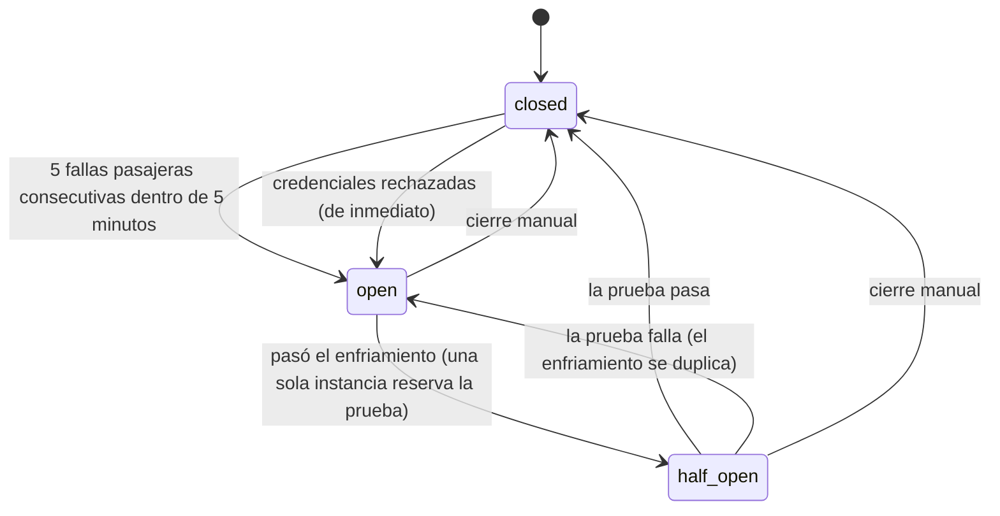

# 0011. Circuit breaker de SAP compartido por todas las instancias

- **Estado:** Aceptada
- **Fecha:** 2026-10-28

## Contexto

Los reintentos con backoff del [ADR 0010](0010-resiliencia-reintentos-dead-letter-y-panel.md) hacen que un pedido sobreviva a una caída de SAP, pero cada job reintenta por su cuenta: con SAP caído, los workers siguen golpeándolo con cada job pendiente, cada intento fallido gasta uno de los 12 del presupuesto del job, y una caída larga manda a la cola entera al dead letter. Además, credenciales mal puestas se tratan como una falla pasajera más: el hub insiste durante horas con una contraseña que SAP rechaza, y SAP bloquea al usuario tras varios inicios de sesión fallidos.

Hace falta que el hub **deje de enviar trabajo a SAP mientras SAP no responde**, sin gastar los intentos de los jobs, y que lo **retome solo** cuando vuelva, sea cual sea la instancia que lo note primero.

## Decisión

Un *circuit breaker* para SAP con tres estados, guardado en PostgreSQL.

### Estado persistido y compartido

La tabla `circuit_breakers` tiene una fila por circuito (hoy, `sap`). Cada cambio se hace en una transacción corta con `SELECT … FOR UPDATE` sobre la fila, de modo que dos instancias nunca deciden a la vez: las fallas simultáneas se suman sin pisarse, el circuito se abre una sola vez y **solo una instancia obtiene la prueba semiabierta**. La reserva de la prueba (`probe_lease_until`) vence sola: si la instancia que la hacía cae, otra la retoma. Guardar el estado en memoria habría dado un circuito por instancia, cada una descubriendo la caída por separado.

La lógica pura (transiciones, racha, enfriamiento) vive en `CircuitBreaker`, en el dominio, y se prueba sin base de datos; `CircuitBreakerStore` solo aporta el bloqueo.

### Cuándo se abre

- **Fallas pasajeras sostenidas**: `Circuit__FailureThreshold` (5) fallas **consecutivas** dentro de `Circuit__FailureWindow` (5 minutos, contados desde la primera de la racha). Cuentan los códigos que hablan de la salud de SAP: `sap.unreachable`, `sap.timeout`, `sap.server_error` y `sap.session`.
- **Cualquier respuesta con sentido reinicia la racha**, incluso un rechazo de negocio (`sap.rejected`: el SKU no existe, el cliente está congelado). Un SAP que rechaza un dato está vivo. Por eso errores intermitentes no abren el circuito: nunca hay cinco seguidos.
- **La ventana es de 5 minutos y no de 1** porque con poco tráfico y backoff las fallas llegan espaciadas (un solo job reintentando espera 30 s, 1 min, 2 min, 4 min…): con una ventana de un minuto la racha se reiniciaría una y otra vez y el circuito no se abriría nunca. Hay una prueba que lo demuestra con las mismas cinco fallas.
- **Credenciales rechazadas** (`sap.invalid_credentials`, el código −304 del login): se abre **de inmediato**, sin esperar la racha. Sigue siendo un error pasajero para el job (basta corregir la configuración para que se complete), pero insistir con una contraseña mala bloquea al usuario de SAP.

### Qué hace abierto

- **Las llamadas a SAP fallan al instante** con `circuit.open` (pasajero) sin llegar a la red: `CircuitBreakingSapGateway` decora a `ISapGateway`.
- **El worker no toma jobs**: todos dependen de SAP, y tomarlos solo gastaría sus intentos. Un job que venía en vuelo cuando el circuito se abrió vuelve a la cola con `SyncJob.Defer`: el presupuesto de intentos del ciclo no se descuenta (`cycle_attempts` vuelve a donde estaba), aunque el intento queda en el historial como `abandoned`.
- **La sincronización periódica de stock se omite** en vez de registrar una ejecución fallida por intervalo.
- El webhook sigue recibiendo y guardando pedidos: el circuito detiene el procesamiento, no la recepción.

### La prueba semiabierta

Pasado el enfriamiento, el primer bucle del worker (de cualquier instancia) que lo note reserva la prueba con una actualización atómica y hace una sola operación liviana: iniciar sesión y leer un artículo. Va directo al adaptador, sin pasar por el circuito (que la rechazaría). Si pasa, el circuito se cierra y la cola se reanuda; si falla, se reabre con el enfriamiento duplicado. Una prueba que lanza una excepción o supera la reserva cuenta como fallida y nunca rompe al worker. Si el hub se apaga a mitad de la prueba, la reserva vence y otra instancia la retoma.

| | Enfriamiento inicial | Crece | Tope |
|---|---|---|---|
| Fallas pasajeras | 30 s | ×2 por cada prueba fallida | 15 min |
| Credenciales rechazadas | 15 min | ×2 | 1 h |

El enfriamiento por credenciales es largo a propósito: probar cada medio minuto con una contraseña mala es exactamente lo que bloquea la cuenta. Quien corrige las credenciales no necesita esperar: cierra el circuito a mano.

### Visibilidad y operación

- **Logs**: cada transición deja un evento estructurado (`CircuitName`, `FromState`, `ToState`, `Reason`, `OpenCount`, `NextProbeAt`, `ErrorCode`): Warning al abrirse, Information al pasar a semiabierto y al cerrarse. En Seq se filtra por `CircuitName = 'sap'`.
- **`/health`**: con el circuito abierto, el chequeo de SAP queda `Degraded` y **no consulta a SAP**: informa el estado compartido (motivo, desde cuándo, próxima prueba) en la descripción y en `data`. El hub sigue en 200: puede recibir pedidos. Con credenciales rechazadas, la descripción dice qué variables revisar.
- **`/admin/metrics`** trae `circuits`; `GET /admin/circuit-breakers` lo lista (clave de lectura); `POST /admin/circuit-breakers/sap/close` lo cierra (clave de operación, auditado).
- **Deshabilitarlo**: `Circuit__Enabled=false` deja el comportamiento del ADR 0010 (solo reintentos con backoff).

Las variables están en [variables de entorno](../variables-de-entorno.md#circuit-breaker-de-sap).

## Alternativas descartadas

- **Un circuito por instancia, en memoria**: cada instancia pagaría el costo de descubrir la caída, y las pruebas semiabiertas se multiplicarían por la cantidad de instancias. Una base de datos compartida ya existe y ya sirve de cola ([ADR 0003](0003-postgresql-como-cola.md)).
- **Una biblioteca (Polly) dentro del cliente HTTP**: su estado es por proceso, no distingue una falla de infraestructura de un rechazo de negocio, y no deja nada visible en el panel ni coordina la prueba entre instancias.
- **Bloquear el webhook con el circuito abierto**: se perderían pedidos; la tienda reintenta pocas veces. Recibir y guardar es barato y no depende de SAP.
- **Contar fallas en una ventana deslizante (cualquier 5 de los últimos N)**: con tráfico mixto un éxito aislado no probaría que SAP se recuperó. «Consecutivas» es más fácil de explicar y de razonar.
- **Probar las credenciales con la misma cadencia que una caída de red**: ver arriba, bloquea al usuario de SAP.

## Consecuencias

- Mientras el circuito está abierto, los pedidos esperan en la cola sin gastar intentos; al cerrarse se procesan todos. Un job puede esperar más de lo que cubren sus 12 intentos sin pasar al dead letter, que ahora significa «falló 12 veces con SAP *sano*».
- El circuito se abre por fallas de SAP, no de la tienda: la tienda solo la usa la sincronización de stock, que es periódica y ya reintenta sola. Aplicarle uno es posible con la misma pieza (el circuito se identifica por nombre) pero no se hizo en esta fase.
- Un SAP que acepta el login pero falla en una operación concreta (siempre la misma) cuenta como falla pasajera solo si el error es de infraestructura; un 400 de negocio no abre nada.
- La prueba lee un artículo: un SAP sano para el login pero roto para la lectura cuenta como caído, que es lo que se quiere.
- El estado del circuito añade una consulta por llamada a SAP (por clave primaria) y una escritura solo cuando hay una racha que reiniciar o una falla que registrar. Con el volumen de esta integración es irrelevante; con mucho tráfico habría que cachear el estado unos segundos.
