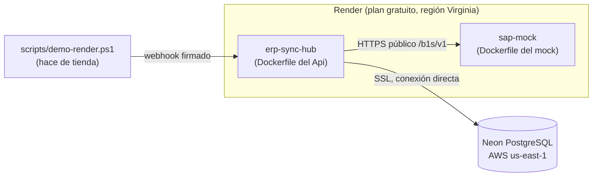

# Despliegue en Render y Neon

El hub y el SAP simulado se despliegan como dos **servicios web** del plan gratuito de [Render](https://render.com), cada uno con su `Dockerfile`, y la base de datos es PostgreSQL de [Neon](https://neon.tech). Es una demo pública, no una instalación de producción: las [limitaciones](#limitaciones-del-plan-gratuito) importan y están al principio a propósito. La decisión y sus alternativas están en el [ADR 0014](adr/0014-despliegue-gratuito-en-render-y-neon.md).



No se despliegan Seq ni la tienda WooCommerce: en producción los logs salen por la **consola** (JSON compacto) y se leen en la pestaña *Logs* de cada servicio de Render. El pedido de la demo lo envía el script `demo-render.ps1`, que firma el webhook como lo haría WooCommerce.

## Limitaciones del plan gratuito

| Limitación | Qué significa para esta demo |
|---|---|
| **Los servicios se duermen sin tráfico.** Render apaga un servicio web gratuito tras unos 15 minutos sin peticiones y lo vuelve a levantar con la siguiente, lo que tarda alrededor de un minuto. | La primera petición tras un rato es lenta. `demo-render.ps1` despierta ambos servicios y espera. Un webhook real que llegue con el hub dormido puede agotar el tiempo de WooCommerce; WooCommerce reintenta las entregas fallidas, pero tras varias fallas seguidas desactiva el webhook. Para algo más que una demo hace falta un plan que no duerma. |
| **La sincronización periódica solo corre mientras el hub está despierto.** El worker y el temporizador de stock y precios viven dentro del proceso del hub. | Si el hub duerme, no hay sincronización ni se procesan jobs ni vencen reintentos: se reanudan al despertar (los jobs pendientes siguen en PostgreSQL, así que no se pierde nada). No se usa ningún *keep-alive* para esquivarlo: sería saltarse una restricción del plan, y esconde el comportamiento que esta sección documenta. |
| **No hay tienda desplegada, así que la sincronización de stock y precios está desactivada.** Sin variables `Store__WooCommerce__*` el hub lo avisa en el log al arrancar y funciona igual para pedidos. | Solo se demuestra el flujo pedido → SAP. Para activar stock y precios habría que apuntar `Store__WooCommerce__*` a una tienda WooCommerce pública por HTTPS. |
| **El SAP simulado guarda su estado en memoria** y Render no ofrece disco persistente en el plan gratuito. | Cada vez que el mock se duerme o se reinicia, vuelve a los datos semilla y pierde las órdenes. El hub lo tolera: si un cliente que tenía mapeado desapareció de SAP, lo vuelve a resolver una vez ([ADR 0008](adr/0008-sincronizacion-de-pedidos.md)). Es esperable en una demo; las órdenes que ves en el mock son las de desde el último arranque. |
| **No hay red privada entre servicios.** | El hub llama al mock por su URL pública HTTPS. Por eso los endpoints `/_mock` del mock exigen `SapMock__AdminApiKey`: sin ella cualquiera podría borrar sus datos o inyectar fallas. El Service Layer simulado sigue aceptando login con la contraseña que definas. |
| **Cuotas.** Render da un número limitado de horas de instancia gratuitas al mes y Neon limita almacenamiento y horas de cómputo; además Neon suspende el cómputo sin actividad y el primer acceso tarda un instante. | Los límites cambian: revisa las páginas de planes de [Render](https://render.com/pricing) y [Neon](https://neon.tech/pricing). Con un tráfico de demo sobra. |

## Lo que haces tú a mano

Nada de esto vive en el repositorio: son cuentas y secretos tuyos.

### 1. Neon

1. Crea un proyecto en [Neon](https://console.neon.tech) en la región **AWS US East 1 (N. Virginia)**, la misma zona que usa Render en el Blueprint (*Virginia*), para que la latencia entre ambos sea mínima.
2. En *Connect*, desmarca *Connection pooling* y copia los datos de la conexión **directa** (el host **sin** `-pooler`). Hace falta la directa porque el hub toma locks de sesión de PostgreSQL (`pg_advisory_lock`), que un pooler en modo transacción no respeta.
3. Usa como `Database__ConnectionString` la URL que muestra Neon, tal cual, **con el host directo** (sin `-pooler`). El hub acepta el formato URL y lo convierte al iniciar:

   ```
   postgresql://<usuario>:<contraseña>@ep-xxxx-xxxx.us-east-1.aws.neon.tech/neondb?sslmode=require&channel_binding=require
   ```

   También sirve el formato de Npgsql (`Host=ep-xxxx-xxxx.us-east-1.aws.neon.tech;Port=5432;Database=neondb;Username=<usuario>;Password=<contraseña>;SSL Mode=Require`). Si la contraseña tiene caracteres especiales (`@ : / ? # % ;`), en la URL van codificados con `%` (por ejemplo `@` es `%40`); Neon ya la entrega así. Los detalles y los parámetros soportados están en [variables de entorno](variables-de-entorno.md#cadena-de-conexión-a-postgresql).

### 2. Genera los secretos

En PowerShell (los valores solo se muestran en pantalla; no se guardan en ningún lado):

```powershell
function New-Hex([int]$bytes) {
    $buffer = [byte[]]::new($bytes)
    [Security.Cryptography.RandomNumberGenerator]::Create().GetBytes($buffer)
    -join ($buffer | ForEach-Object { $_.ToString('x2') })
}

'Webhooks__WooCommerce__Secret = ' + (New-Hex 24)   # mínimo 16 caracteres
'Admin__ReadApiKeys            = ' + (New-Hex 32)   # clave de lectura del panel
'Admin__OperateApiKeys         = ' + (New-Hex 32)   # clave de operación (distinta de la anterior)
'SapMock__Password / SAP__Password = ' + (New-Hex 16)   # la misma en los dos servicios
'SapMock__AdminApiKey          = ' + (New-Hex 32)   # protege los endpoints /_mock
```

Guárdalos en tu gestor de contraseñas. Para usar el script de demo, defínelos también como variables de tu sesión (ver [paso 5](#5-probarlo)).

### 3. Render

1. En el panel de Render: **New → Blueprint**, conecta el repositorio de GitHub y elige la rama `main`. Render lee `render.yaml` y propone los dos servicios `erp-sync-hub` y `sap-mock`.
2. Render pide los valores de las variables marcadas `sync: false` (si no, las cargas después en *Environment* de cada servicio):

   | Servicio | Variable | Valor |
   |---|---|---|
   | `erp-sync-hub` | `Database__ConnectionString` | La cadena de Neon del paso 1. |
   | `erp-sync-hub` | `Webhooks__WooCommerce__Secret` | El secreto del webhook. |
   | `erp-sync-hub` | `SAP__BaseUrl` | La URL pública del `sap-mock` (por ejemplo `https://sap-mock.onrender.com`). Render la muestra al crear el servicio; si el nombre ya estaba ocupado le agrega un sufijo. Si aún no la conoces, pon una provisoria y corrígela después. |
   | `erp-sync-hub` | `SAP__Password` | La contraseña del mock. |
   | `erp-sync-hub` | `Admin__ReadApiKeys` | La clave de lectura. |
   | `erp-sync-hub` | `Admin__OperateApiKeys` | La clave de operación. |
   | `sap-mock` | `SapMock__Password` | La misma contraseña que `SAP__Password`. |
   | `sap-mock` | `SapMock__AdminApiKey` | La clave de `/_mock`. |

3. Espera al primer despliegue de ambos. El hub aplica las migraciones al arrancar (`Database__MigrateOnStartup=true`, ver abajo) y su *health check* es `/health`.
4. Si corregiste `SAP__BaseUrl`, guarda el cambio: Render redespliega el hub solo.

Con `autoDeployTrigger: checksPass`, Render despliega cada commit de `main` **solo si el CI de GitHub pasó**.

### 4. Migraciones al arrancar

El Blueprint fija `Database__MigrateOnStartup=true`: el hub aplica las migraciones pendientes antes de aceptar tráfico. Es seguro porque el plan gratuito corre **una sola instancia**. Con varias instancias (un plan de pago escalado), desactívalo (`false`) y migra como paso aparte del despliegue, para que no compitan. Es la misma variable que usa Compose; ver [variables de entorno](variables-de-entorno.md).

### 5. Probarlo

```powershell
$env:ERPSYNC_WC_WEBHOOK_SECRET     = '<el secreto del webhook>'
$env:ERPSYNC_ADMIN_READ_API_KEYS   = '<la clave de lectura>'
$env:ERPSYNC_SAP_PASSWORD          = '<la contraseña del mock>'

./scripts/demo-render.ps1 -HubUrl https://erp-sync-hub.onrender.com -MockUrl https://sap-mock.onrender.com
```

El script despierta los servicios, envía un pedido firmado, espera a que el job termine, y muestra el job (con sus intentos) y la Orden de Venta que quedó en el SAP simulado. Solo lee el panel, por lo que basta una clave de **lectura**. Cada ejecución crea un pedido y un cliente nuevos.

Para mirarlo a mano, con tu clave de lectura (`X-Api-Key`):

```powershell
Invoke-RestMethod https://erp-sync-hub.onrender.com/admin/jobs -Headers @{ 'X-Api-Key' = $env:ERPSYNC_ADMIN_READ_API_KEYS }
```

## Qué se configura y qué no

Las variables que fija el Blueprint (y las que carga cada persona) son las de [variables de entorno](variables-de-entorno.md); el hub y el mock no necesitan nada más.

- **Producción, no desarrollo:** `ASPNETCORE_ENVIRONMENT=Production` apaga OpenAPI y Scalar (solo existen en desarrollo) y deja los logs en JSON compacto por consola.
- **Puerto:** la imagen escucha en `8080` y el Blueprint fija `PORT=8080` para que Render enrute ahí.
- **Seq:** sin `Seq__ServerUrl` el hub funciona igual, solo con la consola.
- **Datos personales:** el SAP simulado y el pedido de ejemplo son ficticios. Los logs del hub nunca llevan datos personales de pedidos ([ADR 0013](adr/0013-redaccion-de-datos-personales.md)).

## Problemas frecuentes

| Síntoma | Causa probable |
|---|---|
| El hub no arranca y el log dice que `Database:ConnectionString` o `SAP:*` es obligatorio | Falta cargar una variable `sync: false` en Render. |
| `Npgsql… SSL` o error de autenticación | La cadena no es válida (el mensaje del arranque dice qué parámetro; nunca muestra la contraseña), falta `sslmode=require` / `SSL Mode=Require`, o usaste el host `-pooler`. |
| `/health` responde `Degraded` | Postgres está bien pero SAP no responde: el mock está dormido o `SAP__BaseUrl` / `SAP__Password` no coinciden con el mock. El hub sigue aceptando pedidos. |
| El webhook responde 401 | `ERPSYNC_WC_WEBHOOK_SECRET` del script no es el de `Webhooks__WooCommerce__Secret` del hub. |
| Los jobs quedan en `retrying` con errores `sap.*` (por ejemplo `sap.session`) | La contraseña de SAP no coincide: `SAP__Password` (hub) y `SapMock__Password` (mock) deben ser idénticas. |
| `/admin/*` responde 503 | No hay ninguna clave del panel configurada. |
| El demo demora un minuto al principio | Los servicios estaban dormidos; es esperable. |
