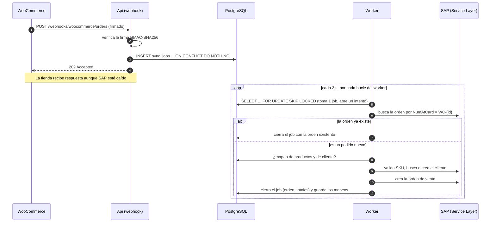
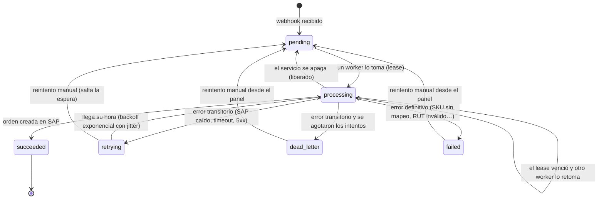

# Flujo de pedidos: tienda → SAP

Cómo viaja un pedido de WooCommerce hasta convertirse en una orden de venta de SAP Business One. Las decisiones de fondo están en el [ADR 0007](adr/0007-inbox-y-cola-con-lease.md) (recepción y cola), el [ADR 0008](adr/0008-sincronizacion-de-pedidos.md) (cómo se convierte el pedido) y el [ADR 0010](adr/0010-resiliencia-reintentos-dead-letter-y-panel.md) (reintentos, dead letter y panel).

## Secuencia

## Estados de un job

- **`retrying`**: falló por un error transitorio y espera su próximo intento. La espera es `30 s × 2^(n-1)` con tope de 1 hora, y se le aplica *jitter* (entre el 50 % y el 100 % de lo calculado) para que los jobs que fallaron juntos no vuelvan a golpear a SAP a la vez.
- **`dead_letter`**: terminal. Se agotaron los 12 intentos; con los valores por defecto eso cubre una caída o mantención de SAP de entre 2 h 32 min y 5 h 4 min de espera acumulada (promedio unas 3 h 48 min), más lo que dure cada intento. Queda a la vista en el [panel](panel.md).
- **`failed`**: terminal. Un error definitivo no se reintenta solo: hay que corregir el dato y reintentarlo a mano.
- Un reintento manual concede un presupuesto de intentos nuevo y conserva el historial.
- Un job que acumula más intentos de los permitidos sin llegar a cerrarse (el worker que lo toma cae una y otra vez) se manda al dead letter sin procesarlo (`job.attempts_exhausted`).

## Endpoint

`POST /webhooks/woocommerce/orders`

| Respuesta | Cuándo |
|---|---|
| `202` | El pedido se guardó (`"status": "accepted"`) o ya estaba guardado (`"status": "duplicate"`). |
| `200` | Era el ping de creación del webhook, o se ignoró: topic sin pedido completo (`order.deleted`) o estado sin pagar (`pending`, `on-hold`, `cancelled`…). |
| `401` | La firma `X-WC-Webhook-Signature` no coincide con el cuerpo. |
| `400` | La firma es válida pero el cuerpo no es un pedido legible. |
| `413` | El cuerpo supera `MaxBodyBytes`. |
| `500` | Falló la base de datos. WooCommerce reintentará. |

Los errores son [ProblemDetails (RFC 9457)](https://www.rfc-editor.org/rfc/rfc9457) en español. En WooCommerce, suscribe los topics **Pedido creado** y **Pedido actualizado**, con el mismo secreto que `Webhooks__WooCommerce__Secret`.

## Configuración

Todo se configura por variables de entorno (`:` se escribe `__`); ver también [variables de entorno](variables-de-entorno.md).

| Variable | Por defecto | Descripción |
|---|---|---|
| `Database__ConnectionString` | — (obligatoria) | Cadena de conexión a PostgreSQL. |
| `Database__MigrateOnStartup` | `false` | Aplica las migraciones al iniciar. |
| `Webhooks__WooCommerce__Secret` | — (obligatoria) | Secreto compartido con el webhook; mínimo 16 caracteres. |
| `Webhooks__WooCommerce__AcceptedStatuses__0…` | `processing`, `completed` | Estados de pedido que se sincronizan. |
| `Webhooks__WooCommerce__MaxBodyBytes` | `1048576` | Tamaño máximo del cuerpo. |
| `SAP__BaseUrl`, `SAP__CompanyDb`, `SAP__UserName`, `SAP__Password` | — (obligatorias) | Conexión al Service Layer ([guía del cliente](../src/SapB1.Client/README.md)). |
| `SAP__RequestTimeout` | `00:00:30` | Tiempo de espera de cada llamada a SAP. |
| `SAP__TaxIdFormat` | `WithDots` | Formato del RUT en `FederalTaxID`: `WithDots` (`12.345.678-5`) o `WithoutDots` (`12345678-5`). Se usa al buscar y al crear clientes. |
| `Sync__WooCommerce__TaxIdMetaKey` | `_billing_rut` | Metadato del pedido que trae el RUT. Vacío lo desactiva. |
| `Sync__WooCommerce__TimeZoneId` | `America/Santiago` | Zona horaria de la tienda, para fechar la orden. |
| `Worker__Enabled` | `true` | Apaga el procesamiento de jobs (la Api igual recibe webhooks). |
| `Worker__PollInterval` | `00:00:02` | Cada cuánto consulta la cola un worker sin trabajo. |
| `Worker__Concurrency` | `2` | Jobs que se procesan a la vez en el proceso. |
| `Worker__LeaseDuration` | `00:05:00` | Tiempo que un worker conserva un job; debe ser mayor que `SAP__RequestTimeout`. |
| `Worker__Retry__MaxAttempts` | `12` | Intentos de un job antes de pasar al dead letter. |
| `Worker__Retry__BaseDelay` | `00:00:30` | Espera tras el primer fallo transitorio; se duplica con cada intento. |
| `Worker__Retry__MaxDelay` | `01:00:00` | Tope de la espera entre intentos. |
| `Admin__ReadApiKeys` · `Admin__OperateApiKeys` | — | Claves de acceso al [panel](panel.md): lectura y operación, cada una con varias separadas por coma. Sin ninguna, el panel responde 503. |
| `Serilog__MinimumLevel__Default` | `Information` | Nivel de registro. |

La configuración se valida al iniciar: si falta algo o es inválido, el servicio no arranca y el mensaje dice qué variable corregir.

## Códigos de error de un job

Quedan en `sync_jobs.last_error_code` y en el intento (`sync_attempts`), con la clasificación con que el backoff decide si reintentar: lo **pasajero** y lo **inesperado** se reintentan; lo **definitivo** no. Los mensajes de error de SAP y de la tienda se guardan sin RUT ni correos (los reemplazan por `[RUT]` y `[correo]`), y los de este servicio nunca los incluyen: el valor está en el payload, que el panel solo entrega con `includePayload=true`.

| Código | Clasificación | Significado |
|---|---|---|
| `order.invalid_payload` | definitivo | El pedido guardado no es legible. |
| `order.without_lines` · `order.line_without_sku` · `order.invalid_quantity` | definitivo | El pedido no se puede convertir en una orden. |
| `order.invalid_tax_id` | definitivo | El RUT del pedido tiene un dígito verificador incorrecto. |
| `order.customer_unidentifiable` | definitivo | Compra como invitado y sin correo. |
| `order.inactive_customer` · `order.inactive_item` | definitivo | El cliente o el artículo está inhabilitado o congelado en SAP. |
| `order.unknown_sku` | definitivo | El SKU no tiene mapeo ni existe como artículo en SAP. |
| `sap.rejected` | definitivo | SAP rechazó la operación (HTTP 4xx); el mensaje trae el motivo de SAP. Si el cliente o el artículo de un **mapeo guardado** ya no existe en SAP, el mapeo se elimina y se resuelve de nuevo una vez en el mismo intento (advertencia en el log); solo queda `failed` si SAP sigue rechazando. |
| `sap.server_error` · `sap.session` · `sap.unreachable` · `sap.timeout` | pasajero | SAP no pudo atender: error del servidor, sesión, red o tiempo de espera. Fallas sostenidas abren el [circuit breaker](adr/0011-circuit-breaker-de-sap.md). |
| `sap.invalid_credentials` | pasajero | SAP rechazó el usuario, la contraseña o la sociedad al iniciar sesión (−304). Abre el circuit breaker de inmediato; corrige `SAP__*` y ciérralo desde el panel. |
| `circuit.open` | pasajero (no gasta intento) | El circuito de SAP está abierto: no se llamó a SAP y el job vuelve a la cola sin descontar un intento. |
| `sap.customer_conflict` | pasajero | SAP dijo que el cliente existe pero no se pudo leer. |
| `job.timeout` | pasajero | El job superó su tiempo máximo (menor que el lease). |
| `job.unexpected` | inesperado (se reintenta) | Un defecto o un problema local; el log tiene el detalle con la excepción completa y nivel `Error`. Si se repite hasta agotar los intentos, queda en el dead letter. |
| `job.attempts_exhausted` | pasajero (dead letter) | El job acumuló más intentos de los permitidos sin cerrarse: el worker que lo tomaba cayó o excedió el lease una y otra vez. |
| `job.unsupported` | definitivo | Origen o tipo de job que este servicio no procesa. |

## Operación

- **Ver el estado:** `GET /health` (PostgreSQL y SAP) y el [panel](panel.md): `GET /admin/jobs` con filtros, `GET /admin/jobs/{id}` con el historial de intentos, `POST /admin/jobs/{id}/retry` y `GET /admin/metrics`.
- **Seguir un job en los logs:** cada línea del worker lleva `JobId`, `Attempt`, `Source` y `ExternalId` como propiedades.
- **Advertencia de totales:** `El total de la tienda (…) difiere del de SAP (…)` indica el desglose; es esperable cuando el pedido tiene envío o IVA.
- **SAP caído:** el hub sigue recibiendo pedidos y `/health` responde `Degraded`. Los jobs quedan `retrying` con espera creciente y se completan solos al volver SAP, sin duplicar la orden; si la caída dura más que los intentos, pasan a `dead_letter` y se reintentan desde el panel.
- **PostgreSQL caído:** el webhook responde `500` y WooCommerce reintenta.
