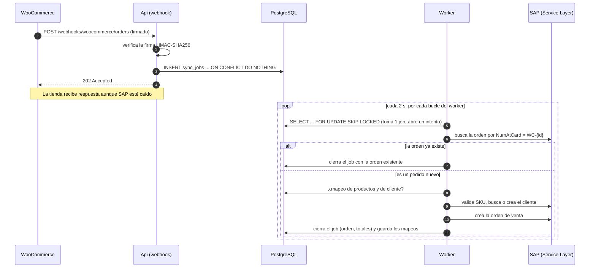
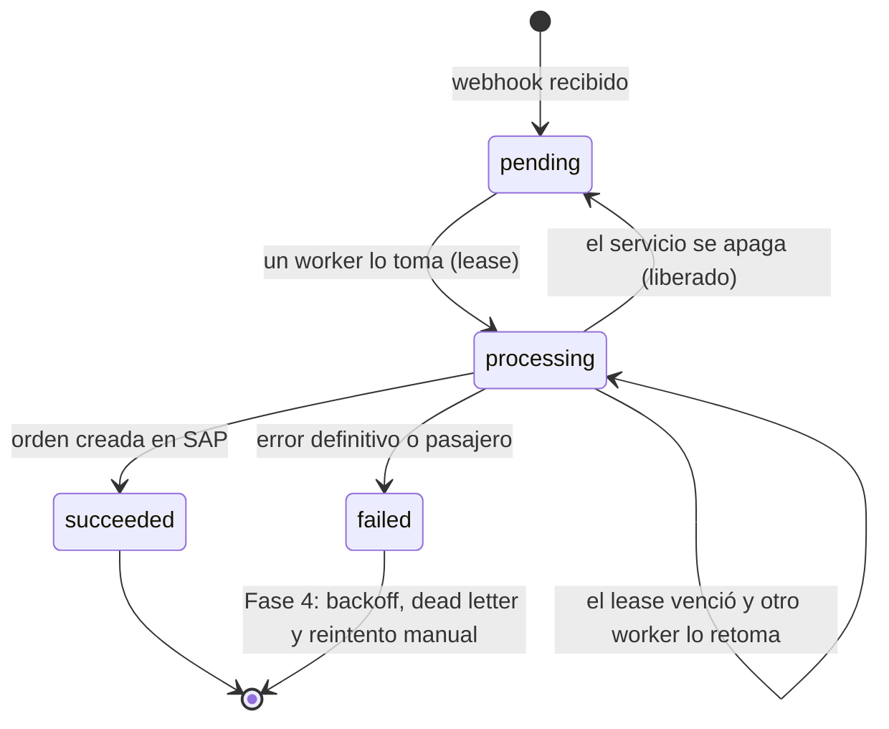

# Flujo de pedidos: tienda → SAP

Cómo viaja un pedido de WooCommerce hasta convertirse en una orden de venta de SAP Business One. Las decisiones de fondo están en el [ADR 0007](adr/0007-inbox-y-cola-con-lease.md) (recepción y cola) y el [ADR 0008](adr/0008-sincronizacion-de-pedidos.md) (cómo se convierte el pedido).

## Secuencia

## Estados de un job

## Endpoint

`POST /webhooks/woocommerce/orders`

| Respuesta | Cuándo |
|---|---|
| `202` | El pedido se guardó (`"status": "accepted"`) o ya estaba guardado (`"status": "duplicate"`). |
| `200` | Era el ping de creación del webhook, o se ignoró: topic sin pedido completo (`order.deleted`) o estado sin pagar (`pending`, `on-hold`, `cancelled`…). |
| `401` | La firma `X-WC-Webhook-Signature` no coincide con el cuerpo. |
| `400` | La firma es válida pero el cuerpo no es un pedido legible. |
| `413` | El cuerpo supera `MaxBodyBytes`. |
| `500` | Falló la base de datos. WooCommerce reintentará. |

Los errores son [ProblemDetails (RFC 9457)](https://www.rfc-editor.org/rfc/rfc9457) en español. En WooCommerce, suscribe los topics **Pedido creado** y **Pedido actualizado**, con el mismo secreto que `Webhooks__WooCommerce__Secret`.

## Configuración

Todo se configura por variables de entorno (`:` se escribe `__`); ver también [`.env.example`](../.env.example).

| Variable | Por defecto | Descripción |
|---|---|---|
| `Database__ConnectionString` | — (obligatoria) | Cadena de conexión a PostgreSQL. |
| `Database__MigrateOnStartup` | `false` | Aplica las migraciones al iniciar. |
| `Webhooks__WooCommerce__Secret` | — (obligatoria) | Secreto compartido con el webhook; mínimo 16 caracteres. |
| `Webhooks__WooCommerce__AcceptedStatuses__0…` | `processing`, `completed` | Estados de pedido que se sincronizan. |
| `Webhooks__WooCommerce__MaxBodyBytes` | `1048576` | Tamaño máximo del cuerpo. |
| `SAP__BaseUrl`, `SAP__CompanyDb`, `SAP__UserName`, `SAP__Password` | — (obligatorias) | Conexión al Service Layer ([guía del cliente](../src/SapB1.Client/README.md)). |
| `SAP__RequestTimeout` | `00:00:30` | Tiempo de espera de cada llamada a SAP. |
| `Sync__WooCommerce__TaxIdMetaKey` | `_billing_rut` | Metadato del pedido que trae el RUT. Vacío lo desactiva. |
| `Sync__WooCommerce__TimeZoneId` | `America/Santiago` | Zona horaria de la tienda, para fechar la orden. |
| `Worker__Enabled` | `true` | Apaga el procesamiento de jobs (la Api igual recibe webhooks). |
| `Worker__PollInterval` | `00:00:02` | Cada cuánto consulta la cola un worker sin trabajo. |
| `Worker__Concurrency` | `2` | Jobs que se procesan a la vez en el proceso. |
| `Worker__LeaseDuration` | `00:05:00` | Tiempo que un worker conserva un job; debe ser mayor que `SAP__RequestTimeout`. |
| `Serilog__MinimumLevel__Default` | `Information` | Nivel de registro. |

La configuración se valida al iniciar: si falta algo o es inválido, el servicio no arranca y el mensaje dice qué variable corregir.

## Códigos de error de un job

Quedan en `sync_jobs.last_error_code` y en el intento (`sync_attempts`), con la clasificación que usará la Fase 4 para decidir los reintentos.

| Código | Clasificación | Significado |
|---|---|---|
| `order.invalid_payload` | definitivo | El pedido guardado no es legible. |
| `order.without_lines` · `order.line_without_sku` · `order.invalid_quantity` | definitivo | El pedido no se puede convertir en una orden. |
| `order.invalid_tax_id` | definitivo | El RUT del pedido tiene un dígito verificador incorrecto. |
| `order.customer_unidentifiable` | definitivo | Compra como invitado y sin correo. |
| `order.inactive_customer` · `order.inactive_item` | definitivo | El cliente o el artículo está inhabilitado o congelado en SAP. |
| `order.unknown_sku` | definitivo | El SKU no tiene mapeo ni existe como artículo en SAP. |
| `sap.rejected` | definitivo | SAP rechazó la operación (HTTP 4xx); el mensaje trae el motivo de SAP. |
| `sap.server_error` · `sap.session` · `sap.unreachable` · `sap.timeout` | pasajero | SAP no pudo atender: error del servidor, sesión, red o tiempo de espera. |
| `sap.customer_conflict` | pasajero | SAP dijo que el cliente existe pero no se pudo leer. |
| `job.timeout` | pasajero | El job superó su tiempo máximo (menor que el lease). |
| `job.unexpected` | inesperado | Un defecto; el registro tiene el detalle. |
| `job.unsupported` | definitivo | Origen o tipo de job que este servicio no procesa. |

## Operación

- **Ver el estado:** `GET /health` (PostgreSQL y SAP) y la tabla `sync_jobs`. El panel para consultar y reintentar jobs llega en la Fase 4.
- **Seguir un job en los logs:** cada línea del worker lleva `JobId`, `Attempt`, `Source` y `ExternalId` como propiedades.
- **Advertencia de totales:** `El total de la tienda (…) difiere del de SAP (…)` indica el desglose; es esperable cuando el pedido tiene envío o IVA.
- **SAP caído:** el hub sigue recibiendo pedidos (los jobs quedan `pending` o `failed` según el momento) y `/health` responde `Degraded`.
- **PostgreSQL caído:** el webhook responde `500` y WooCommerce reintenta.
