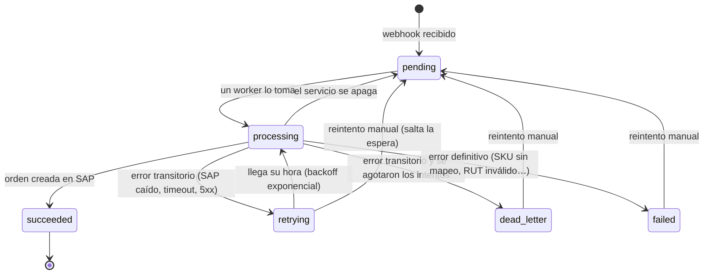

# Panel de administración

API para ver qué está haciendo el hub y corregir lo que falle, sin entrar a la base de datos. Las decisiones de fondo están en el [ADR 0010](adr/0010-resiliencia-reintentos-dead-letter-y-panel.md). La referencia completa y probable desde el navegador está en Scalar (`/scalar`, solo en entorno `Development`).

## Acceso

Todo lo que cuelga de `/admin` exige la cabecera **`X-Api-Key`** con una de las claves de `ERPSYNC_ADMIN_API_KEY` (en el hub, `Admin__ApiKey`). Cómo generarla y rotarla está en [variables de entorno](variables-de-entorno.md#clave-del-panel).

```powershell
$headers = @{ 'X-Api-Key' = $env:ERPSYNC_ADMIN_API_KEY }
Invoke-RestMethod http://localhost:5200/admin/metrics -Headers $headers
```

| Respuesta | Cuándo |
|---|---|
| `401` | Falta la cabecera, la clave es incorrecta o la cabecera está repetida. Aplica también a rutas que no existen bajo `/admin`. |
| `503` | El hub no tiene ninguna clave configurada: el panel está deshabilitado (el resto del hub funciona). |

Los errores son [ProblemDetails (RFC 9457)](https://www.rfc-editor.org/rfc/rfc9457) en español. El webhook de WooCommerce, `/health` y la documentación de desarrollo no usan esta clave.

## Estados de un job



| Estado | Qué hacer |
|---|---|
| `pending` | Nada: un worker lo tomará. Si el más antiguo lleva mucho tiempo, mira las métricas. |
| `processing` | Nada: se está procesando. |
| `retrying` | Nada: se reintentará solo en `nextAttemptAt`. Puedes saltarte la espera con un reintento manual. |
| `succeeded` | Nada: la orden está en SAP (`sap.docNum`). |
| `failed` | Mira `lastError`: un dato del pedido o del maestro está mal. Corrígelo (crea el mapeo, habilita el cliente en SAP, corrige el RUT en la tienda) y reintenta. |
| `dead_letter` | SAP o la tienda estuvieron caídos más de lo que cubren los intentos. Cuando vuelvan, reintenta. |

## Jobs

### `GET /admin/jobs`

Lista los jobs, del más reciente al más antiguo. No incluye el payload.

| Parámetro | Para qué |
|---|---|
| `status` | Uno o varios estados: `status=failed&status=dead_letter` o `status=failed,dead_letter`. Valores: `pending`, `processing`, `retrying`, `succeeded`, `failed`, `dead_letter`. |
| `type` | Tipo de job, por ahora `order`. |
| `externalId` | El id del pedido en la tienda. |
| `from`, `to` | Fecha de creación, ISO 8601: `from` inclusive, `to` exclusive. Sin zona horaria se asume UTC; una fecha sola vale como medianoche. |
| `page`, `pageSize` | Paginación (`pageSize` hasta 100, 20 por defecto). |

```powershell
# Todo lo que necesita atención
Invoke-RestMethod 'http://localhost:5200/admin/jobs?status=failed,dead_letter' -Headers $headers
```

```json
{
  "items": [
    {
      "id": "019a3b1c-7e52-7a41-9f0d-2b6c5e8a1d33",
      "source": "woocommerce",
      "externalId": "5501",
      "type": "order",
      "status": "dead_letter",
      "attemptCount": 12,
      "cycleAttempts": 12,
      "nextAttemptAt": null,
      "lastError": { "code": "sap.unreachable", "message": "No se pudo conectar con SAP: Connection refused" },
      "createdAt": "2026-10-27T14:02:11+00:00",
      "updatedAt": "2026-10-27T19:09:40+00:00",
      "finishedAt": "2026-10-27T19:09:40+00:00",
      "sap": null,
      "storeTotal": 100013.55
    }
  ],
  "page": 1,
  "pageSize": 20,
  "totalItems": 1,
  "totalPages": 1
}
```

`attemptCount` es el historial de toda la vida del job; `cycleAttempts`, los intentos del ciclo actual (lo que cuenta contra el máximo; vuelve a 0 con un reintento manual).

### `GET /admin/jobs/{id}`

El detalle con todos los intentos y errores, del primero al último.

```json
{
  "job": { "id": "…", "status": "retrying", "attemptCount": 2, "nextAttemptAt": "2026-10-27T14:04:11+00:00", "…": "…" },
  "attempts": [
    {
      "number": 1,
      "workerId": "hub-1-1",
      "startedAt": "2026-10-27T14:02:11+00:00",
      "finishedAt": "2026-10-27T14:02:12+00:00",
      "durationSeconds": 1.004,
      "outcome": "failed",
      "errorKind": "transient",
      "error": { "code": "sap.unreachable", "message": "No se pudo conectar con SAP: Connection refused" }
    }
  ],
  "payload": null
}
```

`outcome` es `succeeded`, `failed` o `abandoned` (el worker cayó y otro retomó el job). `errorKind` es la clasificación que usó el backoff: `transient` y `unexpected` se reintentan; `rejected`, `validation`, `not_found` y `conflict`, no.

**El payload trae datos personales** (nombre, correo, teléfono, dirección, RUT): solo se devuelve con `?includePayload=true`, y como objeto JSON. Los logs nunca lo llevan.

### `POST /admin/jobs/{id}/retry`

Deja el job disponible de inmediato con un presupuesto de intentos nuevo; conserva el historial y el último error. Responde 200 con el job (ya `pending`), 404 si no existe y 409 (`code: job.not_retryable`) si está en proceso o ya terminó con éxito.

### `POST /admin/jobs/retry`

Reintenta hasta 100 jobs. Siempre responde 200 con un resultado por id; que uno no se pueda reintentar no impide reintentar a los demás.

```powershell
$ids = (Invoke-RestMethod 'http://localhost:5200/admin/jobs?status=dead_letter&pageSize=100' -Headers $headers).items.id
Invoke-RestMethod http://localhost:5200/admin/jobs/retry -Method Post -Headers $headers -ContentType application/json -Body (@{ ids = $ids } | ConvertTo-Json)
```

```json
{
  "requested": 3,
  "retried": 2,
  "results": [
    { "id": "…", "outcome": "retried", "status": "pending", "message": null },
    { "id": "…", "outcome": "not_retryable", "status": "succeeded", "message": "El job … ya terminó con éxito: no hay nada que reintentar." },
    { "id": "…", "outcome": "not_found", "status": null, "message": "No existe el job …." }
  ]
}
```

`outcome` puede ser `retried`, `not_found`, `not_retryable` o `conflict` (un worker tomó el job justo en ese instante: vuelve a intentarlo).

## Métricas

### `GET /admin/metrics`

```json
{
  "generatedAt": "2026-10-27T19:30:00+00:00",
  "jobs": {
    "total": 412,
    "byStatus": { "pending": 0, "processing": 1, "retrying": 2, "succeeded": 405, "failed": 3, "dead_letter": 1 },
    "oldestPending": null,
    "nextRetryAt": "2026-10-27T19:31:12+00:00"
  },
  "inventorySync": {
    "lastRun": { "id": "…", "trigger": "scheduled", "status": "succeeded", "full": false, "items": { "read": 24, "updated": 1, "unchanged": 23, "skipped": 0, "failed": 0 }, "…": "…" },
    "lastSucceededRun": { "…": "…" }
  }
}
```

- `byStatus` incluye todos los estados, también los que están en cero.
- `oldestPending` es el job pendiente más antiguo: si su `ageSeconds` crece, los workers están detenidos o no dan abasto.
- `nextRetryAt` es cuándo toca el próximo reintento automático.
- `lastRun` es la última sincronización de inventario sea cual sea su resultado; `lastSucceededRun`, la última sin errores. Si difieren, la última tuvo problemas.

## Sincronización de inventario

Ver [flujo de stock y precios](flujo-de-stock-y-precios.md#panel): `POST /admin/sync/inventory` (con `?full=true` para una completa), `GET /admin/sync/inventory/last` y `GET /admin/sync/inventory/runs`.

## Qué mirar cuando algo falla

1. `GET /admin/metrics`: ¿hay jobs en `failed` o `dead_letter`? ¿crece `oldestPending`?
2. `GET /admin/jobs?status=failed,dead_letter,retrying`: ¿qué `lastError.code` se repite? Los códigos están en [flujo de pedidos](flujo-de-pedidos.md#códigos-de-error-de-un-job).
3. `GET /admin/jobs/{id}`: el historial de intentos dice cuándo y por qué falló cada vez.
4. En Seq, `JobId = '<id>'` muestra los logs de ese job; `InventoryRunId = '<id>'`, los de una sincronización de inventario.
5. Corrige la causa (SAP de vuelta, mapeo creado, cliente habilitado) y reintenta.
