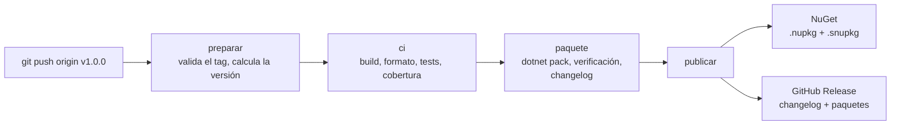

# Cómo se publica un release

Un release sale de **subir un tag `v*`**. No hay pull requests, ni bots que abran PRs, ni archivo de versión que mantener: el tag es la única fuente de la versión ([ADR 0015](adr/0015-releases-por-tag-sin-pull-requests.md)).



El workflow es [`.github/workflows/release.yml`](../.github/workflows/release.yml). Si algo falla antes de `publicar`, no se publica nada.

## Preparación única (a mano)

Son cuentas y secretos tuyos; nada de esto vive en el repositorio.

### NuGet

1. Crea una cuenta en [nuget.org](https://www.nuget.org) y activa la verificación en dos pasos.
2. En **API Keys → Create**, crea una clave:
   - **Key Name:** `erp-sync-hub-release` (el que quieras).
   - **Select Scopes:** *Push* (*Push new packages and package versions*).
   - **Select Packages → Glob Pattern:** `Luarca.SapB1.Client*` (cubre el `.nupkg` y el `.snupkg`).
   - **Expiration:** la más corta que toleres (la máxima es 365 días); anótate la fecha para rotarla.
3. Copia la clave (se muestra una sola vez).

El primer `push` crea el paquete `Luarca.SapB1.Client`. Antes de etiquetar, verifica que el nombre siga libre en nuget.org.

### GitHub

En el repositorio, **Settings → Secrets and variables → Actions → New repository secret**:

| Secreto | Valor | Lo usa |
|---|---|---|
| `NUGET_API_KEY` | La clave de NuGet. | `release.yml` (solo el job `publicar`). |
| `CODECOV_TOKEN` | El token de subida de [Codecov](https://about.codecov.io) (inicia sesión con GitHub, agrega el repositorio y copia *Repository Upload Token*). | `ci.yml`. Sin él, el CI funciona igual y solo omite la subida de cobertura. |

Si en **Settings → Actions → General** restringiste las acciones permitidas, autoriza `codecov/codecov-action`. Los permisos de escritura los declara cada job (`contents: write` solo en `publicar`), así que no hace falta cambiar los permisos por defecto del repositorio.

## Publicar un release

Con la rama ya integrada en `main` y el CI de `main` en verde:

```bash
git switch main && git pull
git tag -a v1.0.0 -m "Descripción corta del release"
git push origin v1.0.0
```

Sigue la ejecución en **Actions → Release**. Al terminar:

- El paquete queda en `https://www.nuget.org/packages/Luarca.SapB1.Client/1.0.0` (los símbolos, en el servidor de símbolos de NuGet, tardan unos minutos en indexarse).
- La Release `v1.0.0` aparece en GitHub, con el changelog y los paquetes adjuntos.

**Las reglas del workflow:**

- El tag debe ser una versión semántica con prefijo `v`: `v1.0.0`, `v1.2.3-rc.1`. Otro formato falla de inmediato.
- Un tag **estable** (sin sufijo) debe apuntar a un commit de `main`. Los **pre-release** (`v1.0.0-rc.1`) pueden salir de cualquier rama; se publican en NuGet como pre-release y la Release se marca como tal.
- La versión del paquete es el tag sin la `v`. No hay ninguna versión en los `.csproj`: los empaquetados locales salen como `0.0.0-local`, a propósito.
- Se ejecuta el CI completo (el mismo workflow `ci.yml`, reutilizado): si falla un test, no se empaqueta ni se publica.
- Antes de publicar se verifica el paquete con [`scripts/verificar-paquete.ps1`](../scripts/verificar-paquete.ps1) (metadatos, licencia, README, aviso de no afiliación con SAP, dependencias, SourceLink).

## Ensayo sin publicar

En **Actions → Release → Run workflow** (sobre la rama que quieras probar) el workflow hace todo salvo publicar: corre el CI, empaqueta con una versión de prueba (`0.0.1-dryrun.N`), verifica el paquete y genera el changelog, que queda en el resumen de la ejecución. El paquete y el changelog se pueden descargar como artefacto `release`. **Nunca** publica: solo un tag lo hace.

El empaquetado también se puede comprobar en local:

```powershell
dotnet pack src/SapB1.Client -c Release -o artifacts -p:Version=1.0.0 -p:ContinuousIntegrationBuild=true
./scripts/verificar-paquete.ps1 -Directory artifacts -Version 1.0.0
./scripts/changelog.sh --repo nachoLuarca/erp-sync-hub HEAD     # en bash
```

## El changelog

[`scripts/changelog.sh`](../scripts/changelog.sh) lista los commits **entre el tag anterior y el actual**, sin los commits de merge, agrupados por el tipo del [Conventional Commit](https://www.conventionalcommits.org/es/v1.0.0/):

| Tipo | Sección |
|---|---|
| `feat` | Funcionalidades |
| `fix` | Correcciones |
| `perf` | Rendimiento |
| `refactor` | Refactorizaciones |
| `docs` | Documentación |
| `test` | Pruebas |
| `chore`, `ci`, `build`, `style` | Mantenimiento |
| cualquier otro | Otros cambios |

Un `!` tras el tipo (`feat!: …`) o un pie `BREAKING CHANGE:` en el cuerpo mueve el commit a **Cambios incompatibles**, que va primero. Un ámbito (`feat(api): …`) se muestra en negrita. Cada línea enlaza a su commit y el final enlaza a la comparación entre ambos tags.

Por eso importa que los mensajes de commit sigan la convención: son la fuente del changelog. El generador tiene sus propias pruebas con repositorios git reales (`ChangelogScriptTests`).

## Si algo sale mal

| Situación | Qué hacer |
|---|---|
| Falla un test o la verificación del paquete | No se publicó nada. Corrige, y vuelve a etiquetar: `git tag -d v1.0.0 && git push origin :refs/tags/v1.0.0`, y repite el tag sobre el commit corregido. |
| Falló `publicar` después de subir a NuGet (por ejemplo, al crear la Release) | Vuelve a ejecutar el job desde la interfaz de Actions (*Re-run*). `--skip-duplicate` evita el error por el paquete ya publicado y se retoma la Release. |
| Falta `NUGET_API_KEY` o venció | El job `publicar` falla con un mensaje claro y la Release no se crea. Carga la clave nueva y vuelve a ejecutar. |
| Se publicó un paquete con un defecto | NuGet no permite reemplazar una versión. Publica `v1.0.1` y, si hace falta, marca la defectuosa como *obsoleta* o quítala de la lista (*Unlist*) desde nuget.org. |
| Un tag con formato inválido | El workflow lo rechaza en `preparar`. Borra el tag y crea el correcto. |
